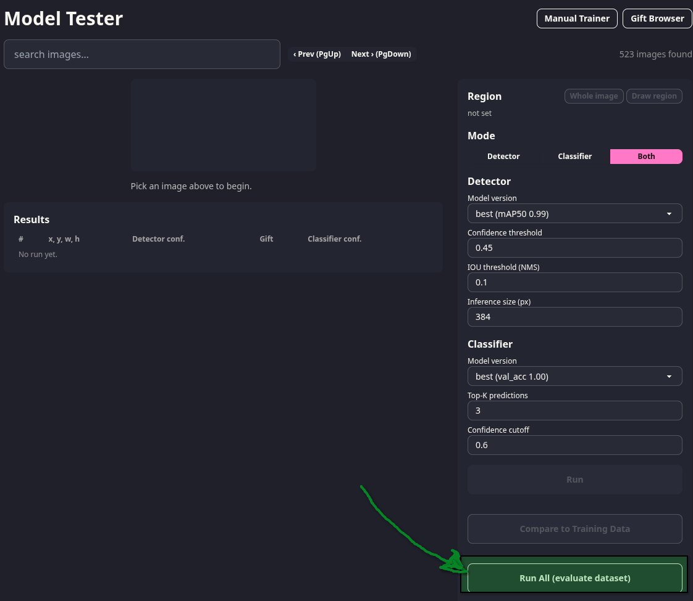
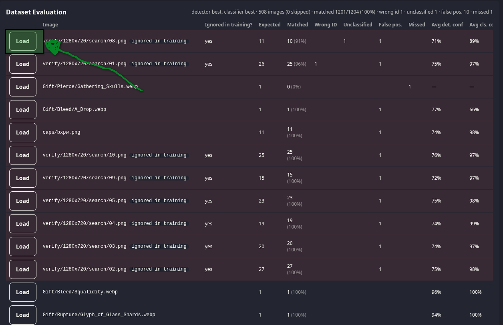
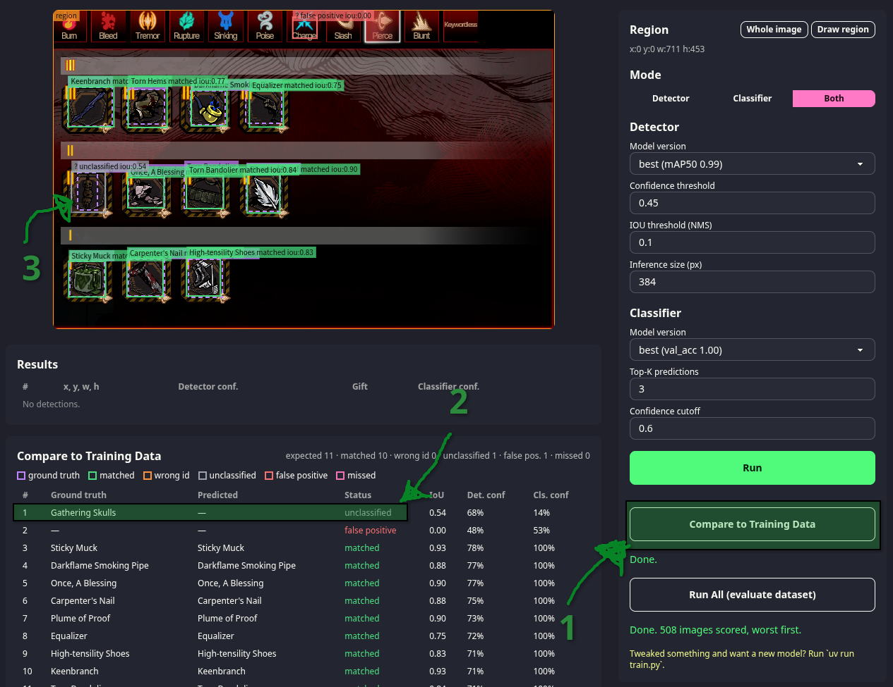

# EgoGiftML

Proof of concept machine learning model to detect ego gifts from Limbus Company

#### Goals
- Model size is under 10MB
- Model can run on commodity hardware, on a CPU, and detect a cluster of ego gifts in under 200ms
- Ego gifts are detected in adversarial/unexpected UI locations
- Only needs OpenCV to load and run

#### Quick Start
```
uv sync
uv run app.py
```
Visit http://localhost:5400/tester/. Scroll down and click "Run All (Evaluate Dataset)"


Wait for results, and then load any image that didn't detect correctly


Click "Compare to Training Data" to see what went wrong with the selected image


#### Approach
- Use YOLO Nano to train a location detection network. Detects where an ego gift might be in an image, but not which gift it is.
- Use MobileNetV3-Small CNN to train a classifier.

In general if you already know the region in an image where an ego gift should be, it may be enough to only use a CNN to detect what it is. I opt for doing a location pass beforehand since it seems to be cheap enough (and provides flexibility). It's also what research literature on vision detection + simple vector icons (like logos) tends to land on. A similar approach you'll see in computer vision educational material is facial recognition, where you crop to someone's face and then use a classifier to detect who it is.
- [Build Your Own Open-Source Logo Detector: A Practical Guide to ACR, Embeddings & Vector Search](https://www.analyticsvidhya.com/blog/2025/12/build-your-own-open-source-logo-detector/)
- [A deep learning pipeline for product recognition on store shelves](https://arxiv.org/pdf/1810.01733)
- [Large Scale Open-Set Deep Logo Detection](https://arxiv.org/pdf/1911.07440)

Note: even if you know the general square where an ego gift is, it might be best to use a region detector for gifts that are not perfectly square.

YOLO (you only look once) specifically tries to provide single pass detection, which didn't work so well for me, but YOLO nano is still a great option for a localization step. Getting single pass to work on things like logos/icons is still an open research problem.

#### Sources
- gll-fun.com (provides datamined resources for ego gifts)
- [LocalizeLimbusCompany](https://github.com/LocalizeLimbusCompany/LocalizeLimbusCompany/), a limbus datamining project for _language_ localization (the vision ML term 'localization' means something entirely different). Really just provides some unity bundle assets that I use to determine sort order for ego gifts. Nothing to do with ML training.
